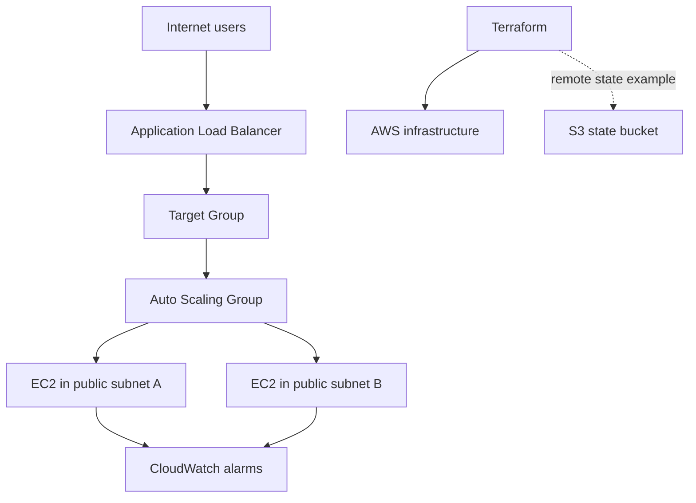

# Web Application Infrastructure on AWS with Terraform

## Goal
Provision a small, multi-AZ web tier using Terraform: VPC, public subnets, internet
gateway, route tables, security groups, Application Load Balancer, launch template,
Auto Scaling Group, EC2 instances, and CloudWatch alarms.

This is a learning implementation. It does not include an application database,
WAF, HTTPS certificate, private application subnets, or a production-grade state
bootstrap workflow.

## Architecture



## Prerequisites
- Terraform 1.6+ (or a compatible recent release)
- AWS CLI configured with a dedicated least-privilege lab identity
- An AWS account and a region that has at least two Availability Zones
- Permission to create VPC, EC2, ELB, IAM instance profile, and CloudWatch resources

## Deploy

1. Review `terraform.tfvars.example`; copy it to `terraform.tfvars`.
2. Set a valid EC2 AMI ID for your chosen region. The example uses an Amazon Linux
   image placeholder; do not assume an AMI ID is portable across regions.
3. Initialize and validate:

```bash
terraform init
terraform fmt -recursive
terraform validate
terraform plan
```

4. Inspect the plan carefully. If it is correct, deploy:

```bash
terraform apply
```

5. Open the `alb_dns_name` output in a browser.
6. Remove resources after testing:

```bash
terraform destroy
```

## Remote state
`backend.tf.example` shows an S3 backend configuration. Terraform backend settings
must be configured before `terraform init`. Create the bucket separately, enable
versioning and encryption, and use a lock mechanism supported by your Terraform
version. Do not commit state files or credentials. For a first test, the project
uses local state unless you intentionally configure the backend.

## Validation checklist
- [ ] `terraform fmt -check -recursive`
- [ ] `terraform validate`
- [ ] Review `terraform plan`
- [ ] ALB DNS returns the demo page
- [ ] Target group reports healthy EC2 targets
- [ ] CloudWatch alarms exist
- [ ] `terraform destroy` completes

## Cost and security
This project creates billable AWS resources (ALB, EC2, EBS, data transfer, CloudWatch).
Use a short test window, set a budget alert, and destroy the stack when finished.
The demo instances are in public subnets and expose HTTP only; do not use this design
for sensitive or production workloads. SSH ingress is disabled by default.
